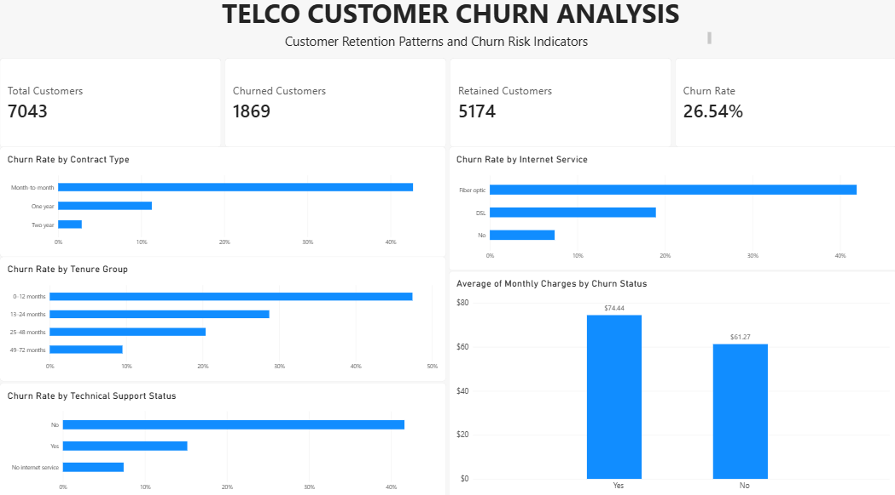

## Telco Customer Churn Analysis

## Project Overview

This project analyses customer churn in a telecommunications company using customer data. The objective is to identify customer segments associated with higher churn rates and develop data-informed recommendations to support customer retention.

## Business Questions

- What is the overall customer churn rate?
- Which contract types have the highest churn rates?
- How is customer tenure associated with churn?
- Do average monthly charges differ between customers who churn and those who remain?
- How does churn vary by internet service and technical support subscription?
- How do churn rates differ between senior and non-senior customers?

## Tools Used

- **Microsoft Excel:** Data cleaning and preparation
- **PostgreSQL:** Data analysis using SQL
- **Microsoft Power BI:** Dashboard development and visualisation

## Key Findings

- **Overall churn:** 26.54% of the 7,043 customers had churned.
- **Contract type:** Month-to-month customers had the highest churn rate at 42.71%.
- **Customer tenure:** Customers with 0–12 months of tenure had a churn rate of 47.44%.
- **Internet service:** Fiber-optic customers had a churn rate of 41.89%.
- **Technical support:** Customers without technical support had a churn rate of 41.64%.
- **Monthly charges:** Customers who churned paid an average of $74.44 per month, compared with $61.27 among customers who remained.

These findings show associations between customer characteristics and churn; they do not establish causation.

## Business Recommendations

1. Investigate the early customer experience and test onboarding improvements.
2. Examine month-to-month contracts to understand pricing, service combinations, and retention opportunities.
3. Investigate fiber-optic customer churn to identify potential service or pricing issues.
4. Evaluate whether targeted technical support interventions could improve retention.

## Project Deliverables

- Project report
- SQL analysis
- Power BI dashboard

- ## Power BI Dashboard

The dashboard summarises customer churn patterns across contract types, internet service, tenure groups, technical support status, and monthly charges.

*Project files and supporting materials will be added as they are prepared.*

## Limitations

This analysis identifies patterns in the available dataset. Further investigation would be needed to establish the reasons for churn and assess the effectiveness of proposed retention strategies.

## Author

**Fowobaje Oluwatomi**

[LinkedIn](https://www.linkedin.com/in/oluwatomi-fowobaje-a10246284/)
